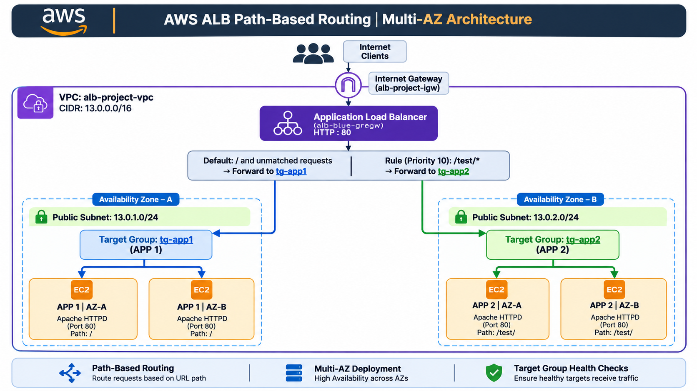

# 🚀 AWS ALB Path-Based Routing | Multi-AZ Web Architecture

> One Load Balancer. Two Applications. Four Servers. Zero excuses for bad routing.



## 📌 Project Overview

This project demonstrates an AWS Application Load Balancer (ALB) implementing path-based routing across multiple Availability Zones.

An internet-facing ALB receives HTTP requests and forwards traffic to different Target Groups depending on the requested URL path. Each application is deployed across two Availability Zones to demonstrate distributed infrastructure and load balancing.

## 🏗️ Architecture

- Custom VPC
- Two public subnets across two Availability Zones
- Internet Gateway
- Application Load Balancer
- Path-based listener rules
- Two Target Groups
- Four EC2 instances
- Apache HTTP Server

## 🛠️ AWS Services Used

| Service | Purpose |
|---|---|
| Amazon VPC | Isolated networking environment |
| EC2 | Hosts web applications |
| Application Load Balancer | Distributes incoming HTTP traffic |
| Target Groups | Organizes backend instances |
| Internet Gateway | Enables internet connectivity |
| Security Groups | Controls network access |

## 🌐 Network Configuration

| Component | Configuration |
|---|---|
| VPC | `13.0.0.0/16` |
| Subnet AZ-A | `13.0.1.0/24` |
| Subnet AZ-B | `13.0.2.0/24` |
| Internet Gateway | Attached to VPC |
| Route Table | Default route via Internet Gateway |

## 💻 EC2 Deployment

Four EC2 instances were deployed across two Availability Zones.

| Instance | Availability Zone | Application |
|---|---|---|
| app1-az-a | AZ-A | APP1 |
| app1-az-b | AZ-B | APP1 |
| app2-az-a | AZ-A | APP2 |
| app2-az-b | AZ-B | APP2 |

Apache HTTP Server was installed and configured using EC2 User Data.

### APP1

Serves the default root path:

`/`

### APP2

Serves the application at:

`/test/`

## ⚖️ Target Groups

### Target Group 1 — tg-app1

- Protocol: HTTP
- Port: 80
- Targets: `app1-az-a`, `app1-az-b`
- Health Check Path: `/`

### Target Group 2 — tg-app2

- Protocol: HTTP
- Port: 80
- Targets: `app2-az-a`, `app2-az-b`
- Health Check Path: `/test/`

Both Target Groups contain backend instances deployed across two Availability Zones.

## 🌍 Application Load Balancer

| Setting | Value |
|---|---|
| Name | `alb-blue-green` |
| Scheme | Internet-facing |
| IP Address Type | IPv4 |
| Listener | HTTP : 80 |
| Default Target Group | `tg-app1` |

## 🔀 Listener Rules

| Priority | Path | Forward Action |
|---|---|---|
| 10 | `/test/*` | `tg-app2` |
| Default | All other requests | `tg-app1` |

## 🔄 Traffic Flow

### APP1 Traffic

```text
User
  |
  v
Application Load Balancer
  |
  v
tg-app1
  |
  +---- app1-az-a
  |
  +---- app1-az-b
```

### APP2 Traffic

```text
User
  |
  v
Application Load Balancer
  |
  v
/test/* Listener Rule
  |
  v
tg-app2
  |
  +---- app2-az-a
  |
  +---- app2-az-b
```

## 🧪 Testing

The ALB DNS name was used to validate routing.

### Default Application

```text
http://ALB-DNS-NAME/
```

Expected result: APP1

### Second Application

```text
http://ALB-DNS-NAME/test/
```

Expected result: APP2

## 🔐 Security Groups

### ALB Security Group

- Inbound HTTP — Port 80
- Source — `0.0.0.0/0`

### EC2 Security Group

- HTTP — Port 80
- SSH — Port 22

For a production environment, EC2 HTTP access should be restricted to the ALB Security Group, and SSH should be restricted to trusted sources or replaced with managed access solutions.

## 🧠 Key Learnings

- Designing custom VPC networking
- Configuring public subnets across Availability Zones
- Deploying EC2 web servers
- Installing Apache using User Data
- Configuring Application Load Balancers
- Implementing path-based routing
- Configuring Target Groups and health checks
- Understanding Multi-AZ architecture
- Troubleshooting unhealthy targets
- Testing application routing through ALB DNS

## 🚀 Future Improvements

- Auto Scaling Groups
- Launch Templates
- HTTPS using ACM
- Route 53
- CloudWatch monitoring and alarms
- AWS WAF
- Infrastructure as Code using Terraform
- Blue-Green Deployment

## 👨‍💻 Author

**Girish Kumar Lohar**

BCA Graduate | Linux | AWS | Docker | DevOps

GitHub: [girishdevps](https://github.com/girishdevps)

---

> Built for learning, deployed for experience, documented for the portfolio.

